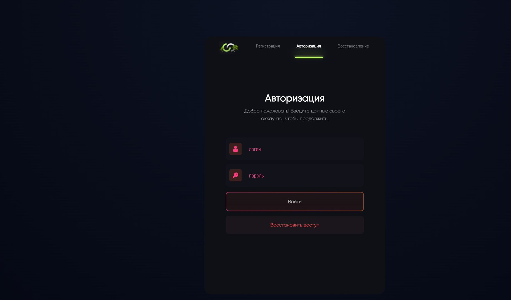

# RAGE MP · Авторизация и регистрация



Архивная работа для **RAGE MP**, опубликованная как часть моего портфолио игровых интерфейсов.

[Открыть демо](https://xtrasupra.github.io/ragemp-auth-ui/?v=authorization-58362c5) · [Исходный код](https://github.com/xtrasupra/ragemp-auth-ui)

## О проекте

Интерфейс объединяет вход в аккаунт, регистрацию, восстановление доступа и выбор персонажа. Это моя ранняя работа: она сохраняет визуальный язык и подход к разработке, с которыми я работал на этом этапе. В репозитории размещена версия из папки `authorization`.

## Возможности

- Три вкладки формы с анимированным индикатором выбранного раздела.
- Поля с плавающими подписями, иконками и цветовой реакцией на ввод.
- Регистрация с подтверждением пароля и согласием с правилами проекта.
- Выбор персонажа, просмотр сведений и переключение места появления.
- Исходная тёмная палитра с лаймовыми, розовыми и оранжевыми акцентами.

## Демонстрационный режим

Демо работает в браузере. Кнопка «Войти» открывает исходную страницу выбора персонажа с тестовыми данными; это демонстрационный переход, без проверки аккаунта. Кнопки регистрации и восстановления показывают уведомление. Введённые значения никуда не отправляются и не сохраняются. Кнопка ↻ в правом верхнем углу возвращает к авторизации.

Игровые события `mp.trigger` сохранены для знакомства с интеграцией CEF и RAGE MP. Полноценная авторизация и действия с персонажами требуют игрового клиента и сервера.

## Запуск

Требуется Node.js 22.12+ или 24+.

```bash
npm ci
npm run dev
```

`npm run build` создаёт сайт в `docs/`. GitHub Pages публикует эту папку из ветки `main`. Пути ресурсов относительные, поэтому демо работает в подпапке репозитория.

## Экраны компьютеров

Сохранена исходная настольная композиция относительно 1920×1080. Интерфейс масштабируется целиком с учётом ширины и высоты окна. Смена вкладок сохраняет расположение формы и её пропорции.

## Подготовка к публикации

Добавлены точка входа Vite, локальный обработчик игровых событий и браузерная обвязка. Выбор страницы подключён к состоянию компонента вместо зависимости от старой версии маршрутизатора. Исправлены относительные импорты, JSX-атрибуты SVG и обновление выбранного спавна. Для отсутствующего в исходниках шрифта Gotham Pro добавлена замена на комплектный Gilroy. Оформление, исходные компоненты и материалы сохранены.

## Автор

Бехтеев Д. Н. ([xtrasupra](https://github.com/xtrasupra)). Работа опубликована как часть личного портфолио. Исходные указания об авторстве и источниках сохраняют силу; игровые обозначения, графика и шрифты принадлежат соответствующим правообладателям.
